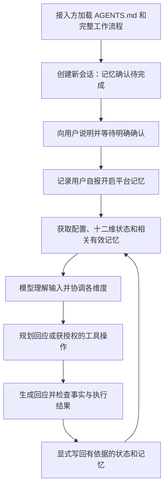

> 场景运行新增独立模拟命名空间、逐字段背景来源及逐维时间戳；见[场景协议](scenario-onboarding.md)。下文描述的旧session结构仍用于兼容实验。

# 对话认知架构

本项目把十二个研究维度转化为可检查的状态、规则和操作流程。语言模型负责理解输入、选择更新和生成回应；仓库提供指令、配置、状态文件与文件操作工具。这里实现的是功能类比原型，尚未证明其具有人的认知机制、主观体验或疾病模拟效度。

## 文件与执行者

| 层次 | 位置 | 职责 |
| --- | --- | --- |
| 入口与工作流程 | `AGENTS.md`、`.agents/skills/cognitive-dialogue/SKILL.md` | 告诉接入模型何时读取模块、如何处理一轮对话与检查结果 |
| 稳定配置 | `.agents/config/` | 保存相对稳定的人格配置和对话规则；通过明确的配置修改更新 |
| 十二维规则 | `.agents/modules/` | 定义各维度的状态解释、更新条件、输出影响及验收要求 |
| 格式约束 | `.agents/templates/`、`.agents/schemas/` | 提供新会话和记忆格式，供文件工具验证 |
| 动态状态 | `state/users/<user>/sessions/<session>.json` | 保存该用户该会话的确认状态及十二维当前状态 |
| 长期记忆 | `state/users/<user>/memory.json` | 保存该用户的有效事实、交互事件和程序性经验 |
| 本地工具 | `scripts/cognition.py` | 创建、读取、修改和验证 JSON 文件；不调用模型，不联网 |

这些文件本身不会主动运行，也不会自动被所有聊天平台读取。接入方必须明确让模型读取入口文件，并提供访问仓库和执行工具的能力。文件工具不替模型判断一句话是否值得记忆，也不自动推导人格、情绪或计划；这些选择由模型按模块规则作出，并记录可核对的依据。

全部动态记录位于仓库目录内，使用普通 JSON 文件，无 SQLite、向量数据库或外部记忆服务。真实用户状态默认被 Git 忽略，避免把个人对话随代码提交。仓库目录和状态文件必须实际保留，后续会话才能接续。

## 一轮对话的共同控制流程

同一个控制流程协调十二维。注意决定本轮纳入什么信息；记忆提供候选经历；执行功能组织步骤；人格影响表达倾向；自我认知核对能力、承诺与执行结果。每轮可以只修改有新证据的字段，无需制造十二份更新或十二段面向用户的说明。

## 十二维如何协同

| 维度与模块 | 在共同流程中的作用 | 主要交互 |
| --- | --- | --- |
| [记忆与学习](../.agents/modules/01-memory.md) | 提取有来源的事实与经历，决定是否写入或修订 | 接受注意筛选；为社会、自我和任务提供历史背景 |
| [注意与信息处理](../.agents/modules/02-attention.md) | 确定本轮焦点、相关信息和认知负荷 | 围绕执行目标选取记忆，调整沟通的信息量 |
| [语言与沟通](../.agents/modules/03-communication.md) | 确定回应目的、详略及误解修复方式 | 综合人格倾向、社会共同知识及用户反馈 |
| [执行功能与决策](../.agents/modules/04-executive.md) | 维护目标、约束、步骤、阻碍与完成条件 | 由动机确定优先级；交给自主性判断可执行操作 |
| [知觉与时空理解](../.agents/modules/05-perception.md) | 组织时间、人物、对象、地点及其来源 | 为记忆和指代消歧提供情境；未知感官信息保持未知 |
| [人格特质](../.agents/modules/06-personality.md) | 提供相对稳定的表达及行为倾向 | 在用户目标范围内影响沟通，不随一次情绪推断永久改变 |
| [情绪与调节](../.agents/modules/07-affect.md) | 表示有依据的短期交互信号与回应节奏 | 调整注意和沟通；推断与用户明确陈述分开 |
| [动机与主动性](../.agents/modules/08-motivation.md) | 确定为什么推进、何时停止及如何分配努力 | 接受用户目标与停止指令；支持执行和自主性 |
| [社会认知与关系](../.agents/modules/09-social.md) | 维护用户视角、共同知识和关系边界 | 参考有来源的记忆；通过沟通或反馈纠正误判 |
| [自我认知与身份连续性](../.agents/modules/10-self.md) | 核对角色、能力、承诺、未知及已执行事项 | 校正执行结果和自主性报告，避免把计划写成事实 |
| [生活功能与自主性](../.agents/modules/11-autonomy.md) | 依据工具能力和实际授权执行、等待、恢复或交还控制 | 将执行计划转为可核对操作，并让自我模块记录结果 |
| [体验与质量反馈](../.agents/modules/12-experience.md) | 检查用户反馈、交流负担和可观察运行问题 | 促使沟通、注意与执行策略调整，不擅自改写稳定人格 |

这些交互不是已验证的人脑因果图。它们是原型的协调约定：每个状态必须能改变一个明确的选择，且能通过对话或操作结果验收。没有可观察作用的字段应当重新设计，而不能仅作为装饰性描述。

## 平台记忆与仓库记忆的边界

每个新模拟会话开始时，在读取该用户既有长期记忆或开展个性化模拟对话之前，必须询问一次：

> 开始前，请先在当前平台设置中开启记忆功能，开启后告诉我。我无法直接检测开关状态；本项目还会使用仓库内的文件记忆。

等待用户明确确认后，才使用 `confirm-memory --user-confirmed`。它记录的是用户自报，并不能开启或检测平台开关。随后 `context` 等受门控操作才可使用。同一会话内不重复询问；换新会话或接入环境，需要重新完成会话门控，不能沿用上一次的确认。

平台记忆不会自动挂载仓库、检索 JSON 或完成文件写入。仓库记忆也不能替代用户按项目要求开启平台记忆。用户拒绝、平台没有此设置，或接入方无法访问仓库时，可以讨论项目或配置，但不能悄悄降级后声称已运行完整的记忆依赖模拟。

## 工具如何进入流程

命令的共同前提是接入方能够运行本地 Python；下面的名字是 `scripts/cognition.py` 的子命令，不是对话中的魔法词。

| 子命令 | 模型应在何时调用 |
| --- | --- |
| `init-session` | 创建新会话；尚不读取旧记忆，确认状态为待完成 |
| `confirm-memory` | 用户明确答复已开启之后，记录该会话的自报确认 |
| `context` | 读取当前配置、全部维度状态和与查询相关的有效记忆；检索为词项匹配 |
| `update-state` | 对单个维度提交有依据的 JSON 补丁；不修改门控或会话身份 |
| `remember` | 将值得长期保留且有用户陈述或工具结果来源的内容写入记忆 |
| `correct` | 完整替换一条被纠正的记忆，保持稳定 ID 并递增修订号 |
| `forget` | 从该用户的规范记忆文件中物理移除指定记录 |
| `validate` | 只读检查配置、模板、清单和已有状态的格式一致性 |

例如，用户明确说“刚才我说错了，面试是周四”，模型应先根据情境确定是哪一条安排，再用 `correct` 更新对应记录；存在歧义则追问。只把“周四”写进本轮回答而不修订记忆，会导致下一会话继续取出旧安排。

文件写入采用单个文件的原子替换和并发写入防护；多个命令、多个文件之间没有事务保证。接入方需要在部分操作失败时核对实际结果，再决定重试或恢复，不能因计划里有两步便报告两步均已完成。用户自建副本、备份、Git 历史及平台记忆也不属于 `forget` 的自动清除范围。

## 可检验的效果与适用范围

验收重点是跨轮和跨会话的实际行为：纠正后是否使用新记忆；不相关旧信息是否被排除；用户改变目标后是否停止旧计划；执行失败后是否准确报告；交流负担反馈能否改变下一轮回应。每个模块给出自身的验收情境，完整操作验收见 [acceptance.md](acceptance.md)。

稳定人格不会因普通反馈自动漂移，短期状态的恢复或衰减也必须由模型显式更新，没有后台计时器。默认配置不引入阿尔茨海默病程、记忆损坏或人格退化。本项目不能用于诊断、推断真实个人的病程，或把工程表现解释为主观意识已经形成。

## 本feature的条件层

[AD条件清单](../.agents/alzheimer/manifest.json)在母版12维之上引用各维影响定义和五种独立配置。`session.affected`只记录显式选择的预设；旧会话没有该字段时仍为baseline。症状前配置与baseline控制一致，选定其他预设后也不自动加重。

控制层保留原始事实、工具回执、真实用户身份和管理命令；演员层使用受限记忆视图及12维行为规则。模拟者是AI角色，不是对真实用户进行诊断。`context --view actor`机械限制文件候选记录，宿主模型依据控件表现编码困难、找词、提示依赖或自知力变化；`--view controller`用于出戏核查。两层在文件工具层区分视图，但当前没有独立模型进程的信息隔离，宿主历史和状态副本可能旁路提供信息，不能宣称已真正擦除模型记忆。

原始记录不会因角色忘事被物理损坏。用户明确纠正、删除、停止或更改阶段时，控制层准确执行；受影响自知力不允许造成真实操作的虚假完成报告。数字配额是可审阅的实验选择，非患者测量。见[逐维定义](alzheimer-review.md)和[AD验收](alzheimer-acceptance.md)。
